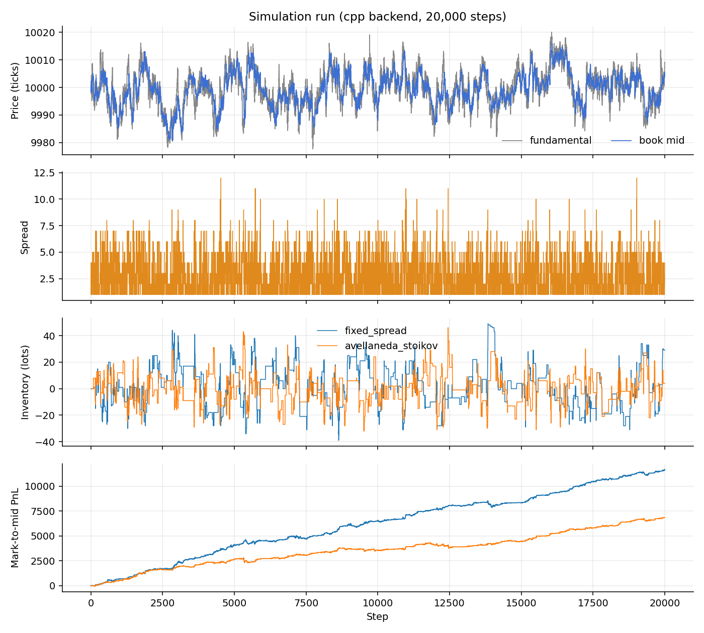
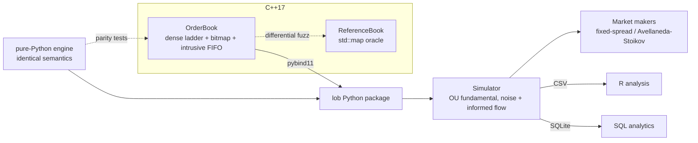
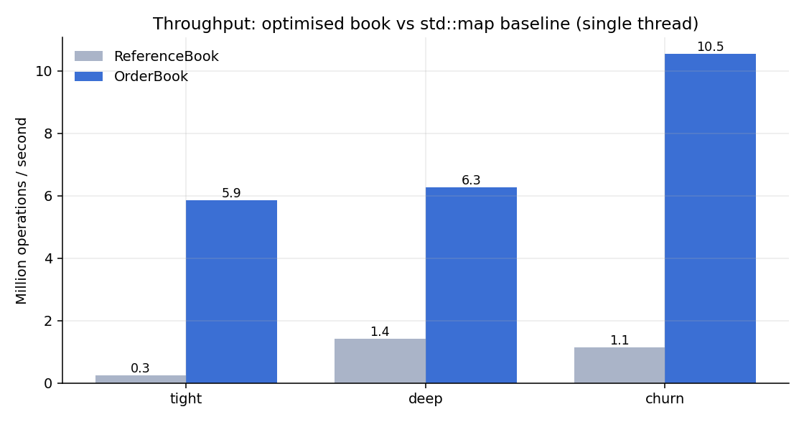
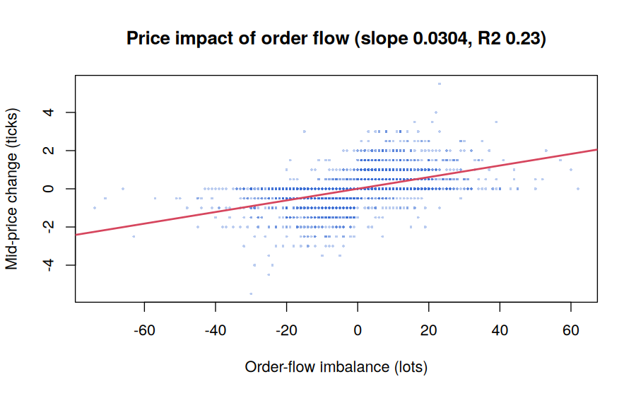
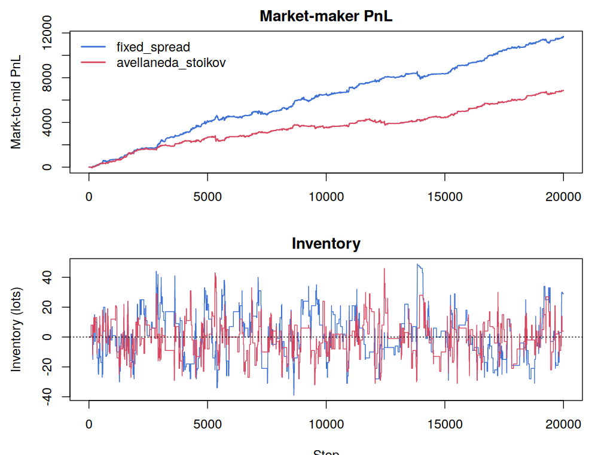

<div align="center">

# lob: Limit Order Book & Matching Engine

**A fast, tested C++17 matching engine with Python bindings, an agent-based market simulator, Avellaneda-Stoikov market making, and analytics in SQL and R.**

[](https://github.com/veritasndiema-ctrl/limit-order-book/actions)
    



</div>

```
$ python -m lob demo
backend=cpp  steps=5,000  trades=5,378  events=51,028  final BBO=9999/10005
        price    qty
  ASK    10010     33  ############
  ASK    10008     65  ########################
  ASK    10005     10  ####
  --- spread 6 | mid 10002.0 ---
  BID     9999     10  ####
  BID     9998     25  #########
  fixed_spread         pnl=     3126  inv_sd=  12.6  max|inv|=   53  fills=280
  avellaneda_stoikov   pnl=     1139  inv_sd=   9.5  max|inv|=   35  fills=269
  price impact: 0.0293 ticks per lot of OFI (R^2=0.22)
```

## Why this repo is different

Most order-book projects stop at "it matches orders". This one tries to *prove* it, and to *use* it.

| | |
|---|---|
| **Fast** | O(1) insert/cancel/best-price: dense price ladder, occupancy bitmap (`ctz`/`clz`), intrusive FIFO lists in a slab. **5.9-10.5 M ops/s** single-threaded; 4-23x faster than the `std::map` baseline ([benchmarks](docs/BENCHMARKS.md), caveats included). |
| **Verified** | ~1.1 M randomised operations per run, compared step-by-step against an independent reference book, under ASan/UBSan, plus a **mutation check** that injects bugs and requires the tests to fail. |
| **Full order semantics** | Limit, market, IOC, FOK, post-only, cancel, reduce (keeps queue priority), replace (loses it). Strict price-time priority, trades at the resting price. |
| **Three languages, one answer** | The same price-impact regression runs in **SQL**, **NumPy** and **R**, and all three agree to the digit. |
| **Runs anywhere** | `pip install .` builds the C++ extension; without a compiler a pure-Python engine with *identical* semantics takes over (tested for parity). |
| **Honest** | Limitations, a changelog of bugs found in the first version, and benchmark caveats are all written down. |

## Quick start

```bash
./run.sh          # one command: install + demo   (also: test, bench, sim, all, clean)
```


```bash
git clone https://github.com/veritasndiema-ctrl/limit-order-book && cd limit-order-book
pip install ".[analysis]"          # builds the C++ extension (needs a C++17 compiler)
python -m lob demo                 # 30-second tour
python -m lob simulate --out results --sqlite --plots
python -m lob sql results/lob.sqlite          # 8 analytical SQL queries
Rscript r/analyze.R results                   # R microstructure analysis (base R only)
```

Native C++ build, tests and benchmark:

```bash
make test        # unit + differential fuzz tests
make bench       # reproduce the numbers below
./build/lob_cli data/sample_orders.csv        # replay an order file, print trades + book
```

### Python API

```python
import lob
from lob import Side, TimeInForce

book = lob.OrderBook()                          # C++ engine if built, else pure Python
book.limit(Side.Sell, 10_010, 8)
book.limit(Side.Buy,  10_000, 10)

r = book.limit(Side.Buy, 10_010, 15, TimeInForce.IOC)    # crosses, takes 8, discards 7
print(r.filled, r.remaining, r.trades[0].price)          # 8 7 10010
book.limit(Side.Buy, 10_020, 100, TimeInForce.FOK).reject.name   # 'FokNotFillable'
book.limit(Side.Buy, 9_999, 5, post_only=True)           # rests; rejected if it would cross
```

## Live dashboard

```bash
python -m lob serve            # then open http://127.0.0.1:8000
```

A browser UI on the real engine, no extra dependencies: order ladder (click a price to fill the ticket), cumulative depth, book mid vs latent fundamental, trade tape, per-strategy PnL / inventory, play / pause / speed / seed / strategy controls, and manual limit & market orders that trade against the simulated market (your own PnL is tracked next to the market makers').

## Architecture



| Path | What |
|---|---|
| `include/lob/`, `src/` | C++ engine (`order_book`), baseline (`reference_book`), pybind11 bindings |
| `tests/` | C++ unit tests (run on both books) + differential fuzzing |
| `benchmarks/bench.cpp` | throughput + latency percentiles, fast vs baseline |
| `apps/lob_cli.cpp` | replay a CSV order file |
| `python/lob/` | backends, simulator, strategies, analytics, SQLite store, plots, CLI |
| `python/lob/sql/` | schema + 8 queries (OFI impact, markouts, PnL attribution, VWAP, ...) |
| `r/` | base-R analysis: ACF/Ljung-Box, price impact `lm`, markouts, strategy metrics |
| `scripts/` | full pipeline, mutation check |

## Performance



| Workload (2 M ops) | OrderBook | std::map baseline | Speed-up | limit p50 / p99 | cancel p50 / p99 |
|---|---|---|---|---|---|
| tight | 5.87 Mops/s | 0.25 | 23x* | 28 / 467 ns | 406 / 914 ns |
| deep | 6.26 Mops/s | 1.41 | 4.4x | 36 / 365 ns | 409 / 904 ns |
| churn | 10.54 Mops/s | 1.14 | 9.2x | 28 / 310 ns | 256 / 806 ns |

<sub>1 vCPU Xeon @ 2.1 GHz (virtualised), g++ 13 `-O3 -march=native`. *The baseline's cancel is O(queue length), so 23x is its worst case. Read the [caveats](docs/BENCHMARKS.md#how-to-read-these-numbers-caveats) before quoting any number. Through the Python API the C++ backend is only ~1.6x faster than pure Python because call overhead dominates.</sub>

## What the simulation shows

An agent-based market: a latent fundamental (Ornstein-Uhlenbeck + jumps), noise traders, and a slice of **informed** market orders that trade toward the fundamental, so passive liquidity providers suffer adverse selection. Market makers quote post-only, and every fill is reconciled from the trade tape by order id.

Fixed spread vs Avellaneda-Stoikov, **10 seeds x 10,000 steps** (mean ± s.e., `python/examples/compare_strategies.py`):

| Strategy | PnL | Inventory s.d. | Max drawdown | PnL / inv-s.d. |
|---|---|---|---|---|
| fixed spread (half = 3) | 6876 ± 393 | 22.1 ± 1.2 | 1158 ± 230 | 324 ± 33 |
| Avellaneda-Stoikov, γ = 0.1 | 3731 ± 302 | 12.9 ± 0.3 | 689 ± 60 | 292 ± 25 |
| Avellaneda-Stoikov, γ = 0.5 | 2437 ± 156 | 4.8 ± 0.1 | 224 ± 20 | 511 ± 38 |

Inventory-aware quoting earns less in absolute terms but takes a fraction of the risk. Another finding: the textbook A-S spread formula ignores informed flow, and with a 1-tick floor it **loses money** here; the spread floor acts as an adverse-selection charge ([notes](docs/MICROSTRUCTURE.md)). These conclusions hold inside this stylised model only.

<table><tr>
<td></td>
<td></td>
</tr></table>

**Cross-language check:** price impact of order-flow imbalance (Cont-Kukanov-Stoikov) for the same run: SQL `0.0304`, NumPy `0.0304`, R `lm` `0.0304` ticks/lot, R² = 0.23.

## Testing

```bash
make test        # 42 C++ tests: semantics on both books + ~1.1 M fuzzed ops vs the reference
make sanitize    # same suite under ASan + UBSan
make mutation    # inject 6 known bugs; every one must make the suite fail
make pytest      # 40 Python tests: backend parity, simulation accounting, SQL vs independent recomputation
```

Things the suite pins down: no crossed book ever; FIFO within a level; trade at resting price; FOK touches nothing when it rejects; a rejected `replace` leaves the original order alive; C++ and Python backends yield **byte-identical** simulations; strategy inventory/cash equal what the raw trade table implies; SQL markouts equal an independent Python computation.

## Limitations

Bounded integer price range; single-threaded; no self-trade prevention, hidden/iceberg/stop orders, auctions or network protocol; synthetic (uncalibrated) order flow. Full list and next steps in [docs/DESIGN.md](docs/DESIGN.md). Version history, including the bugs in the original prototype, in [CHANGELOG.md](CHANGELOG.md).

## Learn more

[Design decisions](docs/DESIGN.md) · [Microstructure primer](docs/MICROSTRUCTURE.md) · [Benchmarks](docs/BENCHMARKS.md) · [Contributing](CONTRIBUTING.md)

## License

MIT. Built by [Keith Ndiema](https://github.com/veritasndiema-ctrl).
